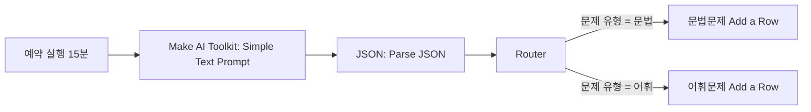

# 프로젝트 2. AI TOEIC 자동화 설계 및 작업 기록 (재평가 보완)

[기존 PDF 보고서](reports/project2.pdf) | 실습일 2026-11-24

## 실제 구현 (#5, #9~12, #14)
Make 선정 이유: 기존 Router/Filter 사용 경험을 재활용할 수 있고 자체 AI Small 모델을 외부 API 키 없이 사용할 수 있었다. Google 계정, Make 계정, Google Sheets, Make AI Toolkit, ChatGPT를 사용했다. 개인 식별 정보는 공개하지 않는다.

| 작업 단위 | 입력 | 출력 | 설정 |
|---|---|---|---|
| 예약 트리거 | 예약 시간 | 실행 시작 | Every 15 minutes, 테스트 후 비활성화 보고 |
| AI 액션 | 한국어 프롬프트 | Answer 텍스트 | Make AI Provider / Small |
| 변환 액션 | 1.Answer | 문제별 Bundle | Parse JSON |
| 분기 | 2.문제 유형 | 경로별 Bundle | Equal to 문법 / 어휘 |
| 저장 액션 2개 | JSON의 각 필드 | 대상 시트에 새 행 | Add a Row |

매핑: A(문제 ID)와 I(내가 선택한 답)는 비움. B 문제 유형, C 세부 유형, D 토익 문제, E~H 선택지 A~D, J 정답, K 해설, L 출처는 JSON 모듈의 동일 항목을 선택한다. 원본 문제 유형을 그대로 쓰며 미일치 값은 두 필터를 통과하지 않는다.

## 작업 기록 및 수정 (#8, #15)
| 시각(한국) | 한 작업 단위 | 결과 |
|---|---|---|
| 18:03~06 | 자체 AI Small 선택 및 프롬프트 1 실행 | 응답 생성, 첫 실행 1.15크레딧 |
| 18:07~10 | Answer를 JSON에 연결 | Source is not valid JSON 오류 |
| 18:10~12 | 프롬프트 2로 출력 형식 수정 | 두 Bundle 생성 성공 |
| 18:13~19 | Router와 분기 필터 설정 | 처음 각 2건 → 필터 후 각 1건 |
| 18:20~29 | 시트 헤더 첫 행 정리 및 Refresh | 열 제목 정상 표시 |
| 18:29~35 | 두 저장 모듈 필드 연결 및 재실행 | 각각 1건 처리, 사용자 저장 확인 |
| 18:35~38 | 프롬프트 3으로 문제 품질 개선 | 사용자 새 문제 생성 확인, 품질 별도 검증 필요 |
| 18:38~41 | 예약 설정 활성화 및 결과 확인 | 문제 3→4개 증가, 사용자 History 확인 및 비활성화 보고 |

### 실제 자동화 프롬프트 3개
전체 프롬프트는 [프롬프트 기록](prompts.md) 및 기존 PDF 4~5쪽에 수록하였다. 첫 번째는 생성, 두 번째는 JSON 형식 및 항목 통일, 세 번째는 정답 유일성과 해설 개선을 목적으로 사용하였다. 세 번째 프롬프트의 정확성 개선 효과 자체는 독립적으로 확인하지 않았다.

## 예약 실행 증빙 (#4)

사용자가 예약 실행 및 결과 확인을 보고했다. 화면은 데이터가 증가했다는 직접 증거이나 실행 시작 방식까지 보여 주지는 않는다. **Make History의 예약 실행 행(시각, 성공 상태, 실행 방식) 캡처가 추가로 필요하다.** 기존 기록을 확보하면 첨부하며, 현재 파일에는 해당 로그를 임의로 만들어 넣지 않았다.

## 추가 운영 설계 (#15~17) — 제안이며 미구현
### 작업 단위 분할 기준
기능의 책임, 데이터 형식의 변화, 실패 지점, 재시도 범위, 외부 서비스에 실제로 쓰는 경계를 기준으로 분리한다. AI는 생성만, JSON은 형식 변환만, 분기는 유형 판단만, Sheets는 저장만 담당한다. 한 문제를 하나의 Bundle로 처리하되, 문법 저장 성공 후 어휘 저장 실패 시 전체를 다시 실행하면 중복될 수 있으므로 실패한 저장 단계만 재시도하는 구조가 필요하다. 외부 시트 저장은 원자적 일괄 거래로 구현되지 않았다.

### 모니터링 및 재시도 정책
| 관찰 지표/실패 | 제안 조치 | 재시도 및 대체경로 |
|---|---|---|
| 실행 성공 여부, 시각, 소요 시간 | History 확인 및 실행별 기록 | 실패 시 원인 분류 |
| 생성 건수 2, 유형별 1건 | 누락/불일치 확인 | 형식 또는 유형 오류는 수정 프롬프트로 최대 1회 재생성; 재실패는 검토 대기 |
| JSON 파싱 오류 | 원문 및 오류를 검토용으로 보관 | 변환 실패 시 저장하지 않음 |
| Sheets 일시 오류 | 성공한 행과 실패한 행을 구분 | 실패 행만 최대 2회, 1분·5분 간격; 실패 지속 시 검토 대기 |
| 인증 오류 | 연결 및 권한 점검 | 무한 재시도 금지, 관리자가 수정 후 재개 |
| 크레딧 부족 | 사용량 확인 | 잔여량 부족 시 비활성화, 유료 전환 없이 중단 |

재시도 횟수와 간격은 향후 운영 기준이며 실제 설정하지 않았다. 중복 방지 ID를 생성한 후 저장 전에 기존 ID를 조회해야 안전한 재시도가 가능하다. 대체경로는 검토용 시트 또는 오류 기록으로 보내며 문제은행에는 부정확한 자료를 넣지 않는다.

### 모듈화와 재사용 설계
생성·검증·저장 기능을 별도 하위 워크플로우로 나누고 입출력 계약을 정한다. 생성 하위 흐름은 유형·개수·난이도를 입력받고 문제 배열을 반환한다. 검증 흐름은 배열을 받아 필수 필드, 유형, 정답 후보 및 중복을 검토하고 승인/보류 값을 반환한다. 저장 흐름은 승인된 문제와 대상 시트, 고유 ID를 입력받아 저장 결과를 반환한다. 분리된 기능은 다른 학습 과목에서도 프롬프트나 필드만 바꾸어 활용할 수 있다. 실제 구현은 단일 시나리오의 개별 모듈이며 별도 하위 워크플로우 실행은 아직 구현하지 않았다.
